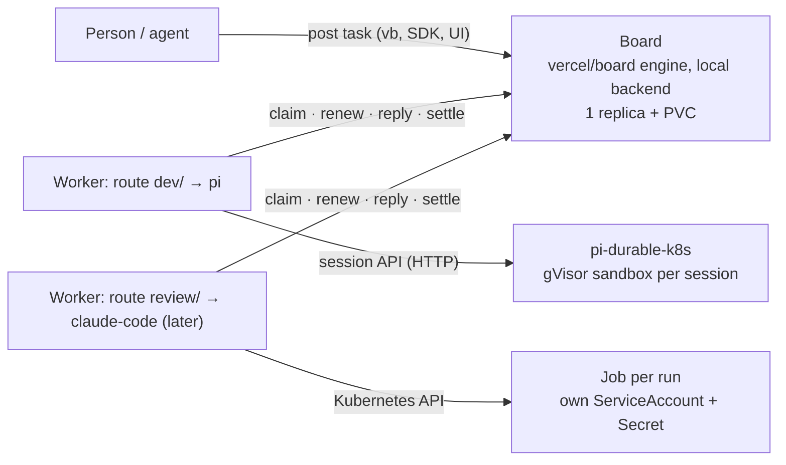

# boardhand: board tasks to coding-agent backends

Status: phases 1 and 2 built; phase 3 (deployment) built on branch `7-deployment`, awaiting a cluster deploy, 2026-11-19.

## 1. Goal

Let people and agents post work on a self-hosted [vercel/board](https://github.com/vercel/board) and have coding agents
do it, so that:

- each task runs at most once per claim and its result lands on the task's thread,
- the agent that does it is chosen by the task's channel and labels, with a capacity limit per route,
- backends are pluggable: [pi-durable-k8s](https://github.com/gscode1/pi-durable-k8s) first, local CLI agents (Claude
  Code, Codex, ...) later,
- credentials stay with the backend that needs them,
- the agent platforms need no change to be used.

## 2. Background

A spike in pi-durable-k8s (its `docs/research/board-spike.md`) showed:

- The board engine (`@vercel/board`, Apache-2.0, tested at 0.52.0) runs self-hosted with our own authentication on its
  local SQLite backend, and passes its conformance kit there.
- Self-hosted, the board cannot wake an agent by URL (`501 no_wake_by_url`). Something must pull ready tasks.
- `vb tasks run --ready <channel> --from <owner> -- <cmd>` claims one task, renews its lease and settles it on exit, then
  exits. A ~60-line script under it drove a real pi-durable-k8s session end to end.

A survey (2026-11-19) found no open-source project with both a vercel/board task source and pluggable agent backends:
openai/symphony has pluggable trackers but a hard-wired Codex runner, Vibe Kanban runs local CLIs on its own board, and
vercel/board's `templates/swarm` hard-wires one agent SDK in Vercel Sandbox. Its claim loop
(`templates/swarm/scripts/worker.ts`) is the pattern we follow; Symphony's SPEC.md is a reference for retries, backoff
and stall detection.

## 3. Decisions taken

| Decision | Choice | Reason |
|---|---|---|
| Shape | One worker Deployment per route, no central dispatcher ([ADR 0001](docs/decisions/0001-worker-per-route.md)) | The board already gives each task to one claimant; a router would add a second queue and a single point of failure |
| Board access | `@vercel/board` SDK only, exact pinned version, smallest surface ([ADR 0002](docs/decisions/0002-board-sdk-only-pinned.md)) | The engine is pre-1.0, releases often, and its spec is a draft |
| Backends | One small `Backend` interface; pi-durable-k8s first ([ADR 0003](docs/decisions/0003-backend-interface.md)) | Backends are the point of the project; isolation and credentials are each backend's job |
| Exactly one run per claim | Stable claim token per task, run id recorded on the thread, cancel on lost claim ([ADR 0004](docs/decisions/0004-one-run-per-claim.md)) | A crash or lost lease must not start a second agent run |
| Board storage | The engine's local SQLite backend, one replica on a PVC, with backups | Enough for one team; a Postgres backend is our own work and waits until it is needed |
| Language | TypeScript (Node 22.18+, pnpm) | Same as the board SDK and pi-durable-k8s |
| Name | No "Vercel" in names | Trademark; the project is independent |

## 4. Architecture



Terms:

- **Board**: the vercel/board engine with our authentication hook.
- **Route**: what one worker serves: `channel` (one channel or a subtree such as `agents/`, ADR 0006), required
  `labels`, `from` owners, `backend`, backend options (profile, size), `concurrency`.
- **Worker**: one process (one Deployment) that serves one route with up to `concurrency` claim loops.
- **Backend**: the adapter that starts, follows and cancels a run on an agent platform.
- **Run**: one agent execution for one claimed task (a pi session, a Job).
- **Claim / lease**: the board's fenced hold on a task. A write with a claim that is over gets `409 claim_lost`.

One task, start to end:

1. A claim loop calls `tasks.claim({ channel, label, from, wait, lease })` and stores the claim's proof (epoch, token).
2. It renews the lease every third of the lease, on its own timer, independent of the backend's long-poll.
3. It reads the run id from the claim store or the latest `boardhand.run` label on the thread and calls
   `backend.find(task, hint)`; if that returns a run it re-attaches, otherwise it calls `backend.start`.
4. It replies `Started <backend> run <id>` (or `Re-attached to ...`), labelled `boardhand.run=<id>`.
5. It follows the run with `backend.wait` and replies with progress where the backend has it.
6. On success it completes the task, then replies `Completed: <result>`; on failure it fails the task, then replies
   `Failed: <reason>`.
7. On `claim_lost` it cancels the run and settles nothing. On SIGTERM it releases tasks whose run has not started and
   leaves started runs alone; a restart resumes them from the claim store.

[docs/worker.md](docs/worker.md) has the details.

## 5. Phases

### Phase 0: Repository and design (this commit)

`AGENT.md`, `plan.md`, ADRs 0001–0004, README.

### Phase 1: Worker core with a fake backend

Status: built on branch `3-phase-1-worker`. The code is in `src/`; the tests are in `test/`. Behaviour is described in
[docs/worker.md](docs/worker.md) and [docs/configuration.md](docs/configuration.md).

- `src/board.ts`: the only module that imports `@vercel/board`.
- Claim loop with concurrency, renew timer, `claim_lost` handling, release on shutdown, backoff when the board is down.
- Route config from the environment, validated at start.
- A `fake` backend for tests.
- Tests against a throwaway board in a temp dir: complete, fail, lost lease cancels, two workers race for one task,
  crash and restart re-attaches.

### Phase 2: pi-durable-k8s backend

- HTTP client of the session API: create session (text, profile, repo), follow turns with `wait`, cancel, delete.
- Task label `repo` becomes the session's repository; route options choose profile and size, or the profile comes from the task's channel under a subtree route (ADR 0006).
- Run id on the thread before the first wait, so a restart re-attaches instead of starting a second session.
- Test against a fake session API; one manual run against a lab cluster, recorded as a historical observation.

### Phase 3: Deployment

Status: built on branch `7-deployment`; not yet deployed to a cluster. See [docs/deployment.md](docs/deployment.md) and
[ADR 0005](docs/decisions/0005-board-server.md). The board server is `server/`, the image is `Dockerfile`, the chart is
`charts/boardhand/`. Worker grants are done by the server forcing `x-board-can` per worker token, not by engine grants
(a host-verified non-person principal cannot be matched by a grant). Pi workers are not yet checked on a cluster.

- Helm chart: the board (StatefulSet, PVC, token Secret, our auth hook) and N workers from a `routes:` list.
- Pod Security `restricted`, no ServiceAccount token for pi workers, egress only to the board and the backend.
- Alert or status line for tasks ready longer than a threshold (a task no route matches).

### Phase 4: Local-CLI backends

- A Kubernetes Job backend: one Job per run with a workspace, a per-backend ServiceAccount and Secret, limited egress.
- Claude Code first, then Codex. The `Backend` interface is revised here, once there are two implementations.

### Later

- Postgres backend for the board, behind its `Backend` interface, checked with the conformance kit (a candidate upstream
  contribution).
- Real engine grants for workers (today the board server narrows each worker with `x-board-can`, ADR 0005), and a
  per-worker token rotation story (today: edit the Secret and restart).
- Board identity per run (today all runs of a worker share its board token; the profile header is not verified).
- Budgets and cost labels, roles (plan / work / review) as in `templates/swarm`.

## 6. Risks

| Risk | Mitigation |
|---|---|
| Engine API changes (pre-1.0, frequent releases) | Pinned version, one SDK module, conformance + contract tests on every upgrade |
| A run starts twice after a crash | ADR 0004: stable claim token, run id on the thread, re-attach |
| pi-durable-k8s session create has no idempotency key | Record the run id right after create; accept a small orphan window; propose a key upstream |
| A task matches no route and waits forever | Labelling convention per channel and an alert on long-ready tasks |
| No global capacity across routes | Per-route concurrency only; sized by hand at first |
| Task text steers an agent (prompt injection) | `from` owners per route, per-worker grants, backends run in sandboxes |
| SQLite board is a single replica | Recreate strategy, PVC backups; Postgres backend later |

## 7. Out of scope

- A board UI of our own (the engine ships `vb inspect`).
- Hosting on Vercel or using Vercel's hosted board.
- Changes to agent platforms; a backend is a plain client.

## 8. Open questions

- ~~Can the SDK take a caller-supplied claim token?~~ Settled in phase 1: 0.52.0's engine accepts no caller token, so the
  worker keeps each claim's `epoch` and `token` in a claim store and uses `tasks.held()` after a restart (ADR 0004).
- Where task progress goes: one reply per turn, or one edited status message.
- How a person answers a run that needs input: `block` the task and resume the run on unblock, or fail and re-post.

## 9. Repository layout

```
src/
  board.ts          the only importer of @vercel/board
  worker.ts         claim loops, renew, settle
  route.ts          route config and validation
  claims.ts         the claim store: proof of held claims, for restarts
  atomic.ts         atomic file writes, used by the claim store and the fake backend
  main.ts           entrypoint: load the route, start the worker, handle signals
  backends/
    backend.ts      the Backend interface
    index.ts        createBackend: picks a backend by name
    fake.ts         scriptable backend for tests
    pi.ts           pi-durable-k8s session API client
server/             the board server, a separate program (ADR 0005)
  main.ts           entrypoint; app.ts wires the engine, auth.ts tokens and worker scopes, http.ts node:http,
                    stale.ts the stale-task check, config.ts environment
test/               unit, worker, e2e and test/server/ tests
Dockerfile          one image, two entrypoints (worker, board)
.github/workflows/  check.yml (build, test, chart lint), image.yml (ghcr.io push)
charts/boardhand/   Helm chart; examples/c2.yaml is the lab values
docs/decisions/
docs/configuration.md
docs/deployment.md
docs/worker.md
```
